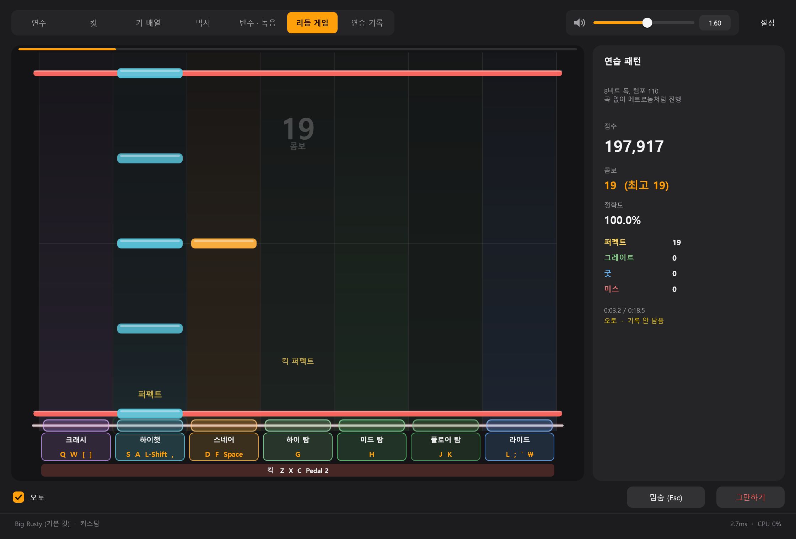
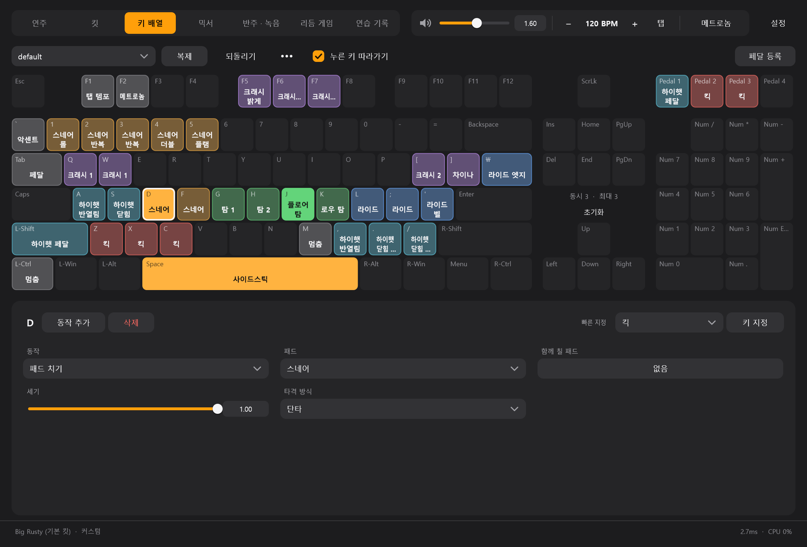
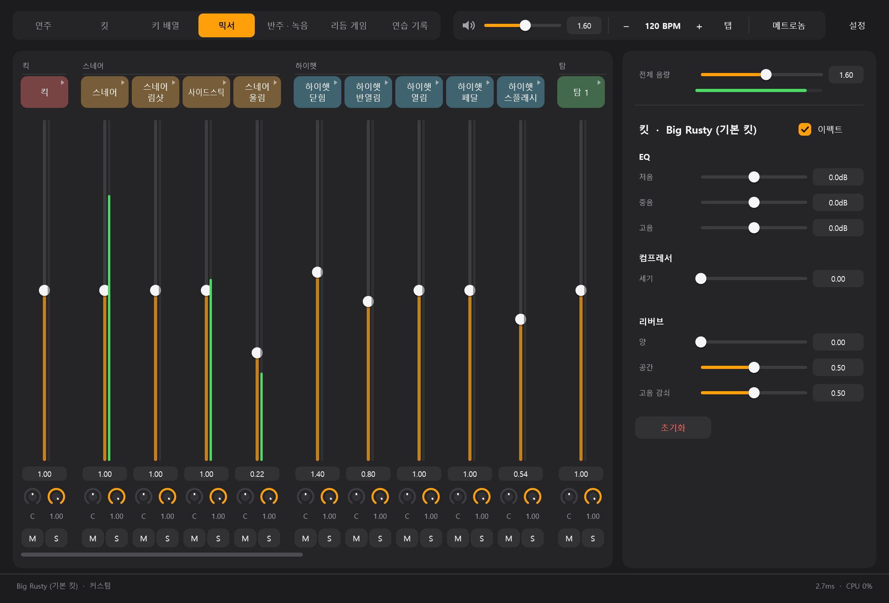
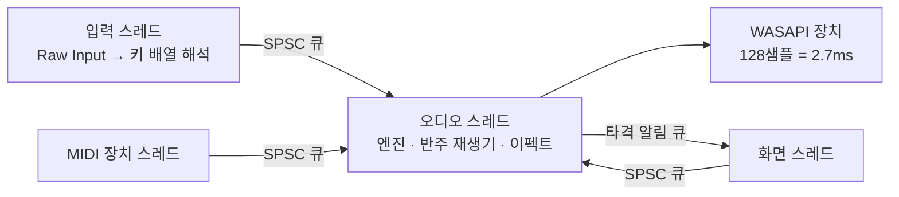

# Hogyun's Virtual Drum

PC 키보드(와 마우스, 풋스위치, MIDI 패드)로 연주하는 Windows용 가상 드럼입니다. 혼자 쓰려고 만든 취미 프로젝트이고, 화면은 한국어입니다.


## 할 수 있는 것

- **연주**: 키나 드럼 그림의 패드를 누르면 울립니다. Raw Input으로 키를 받고, 내장 사운드에서 2.7ms 버퍼(WASAPI 저지연 공유 모드)로 돕니다.
- **키 배열**: 키마다 패드와 세기를 정합니다. 누르고 있는 동안의 연타, 버즈 롤, 심벌 스웰(점점 커지는 연타), 더블, 플램, 패턴 반복, 세기 보조 키가 있습니다.
- **풋스위치**: 키보드로 잡히는 USB 풋스위치를 페달로 등록해 키보드와 따로 씁니다. 하이햇 페달을 떼면 반열림, 밟았다 바로 떼면 풋 스플래시가 납니다.
- **실제 드럼처럼**: 킥이나 탐을 치면 스네어 줄이 함께 작게 떨고, 심벌을 오른쪽 단추로 누르면 손으로 잡은 것처럼 멈춥니다.
- **킷**: 패드마다 음량, 팬, 피치, 리버브, 세기 곡선을 다듬고, 모아 둔 소리 가운데 하나를 고릅니다. SFZ 킷도 가져옵니다.
- **믹서와 이펙트**: 드럼 전체에 EQ, 컴프레서, 리버브, 리미터.
- **반주와 녹음**: 음악 파일을 틀고 따라 칩니다. 속도를 바꿔도 음높이는 그대로이고 구간 반복이 됩니다. WAV 녹음, MIDI 내보내기.
- **리듬 게임**: 음악 폴더의 곡에서 드럼을 받아 적어 채보를 만들고, 내려오는 노트에 맞춰 칩니다.
- **연주 로그와 연습 기록**: 친 것이 저절로 파일에 남고, 곡에 맞춰 친 연주의 박자를 악기별, 구간별로 보여 줍니다.
- **자동 백업**: 킷과 키 배열을 고칠 때마다 이전 상태가 남고, 화면에서 되돌립니다.

| 리듬 게임 | 키 배열 |
|---|---|
|  |  |

| 킷 | 믹서 |
|---|---|
|  |  |

## 기술 스택

| 영역 | 사용한 것 |
|---|---|
| 언어 | C++20 (MSVC) |
| 프레임워크 | JUCE 9.0.6 (화면, 오디오 장치, 파일 형식). 코어 로직은 JUCE 없는 순수 C++ |
| 오디오 출력 | WASAPI 저지연 공유 모드, 128샘플(48kHz에서 2.7ms). ASIO 없이 내장 사운드로 |
| 입력 | Win32 Raw Input (키보드, 풋스위치), MIDI |
| 빌드 | CMake + Ninja. JUCE의 CMake 함수 없이 모듈 소스를 직접 컴파일 |
| 드럼 분리 | Demucs 4.1 (htdemucs) + PyTorch 2.8 (CUDA) |
| 도구 | Python 3.12, ffmpeg, PowerShell 7 |
| 데이터 | JSON (킷, 키 배열, 채보), JSON Lines (연주 로그) |

C++ 약 27,000줄(코어 6,800, 앱 17,500, 테스트 2,800).

## 구조

### 잠금 없는 오디오 경로

악기는 누른 순간 소리가 나야 합니다. 키 입력부터 소리까지의 길에는 잠금도 메모리 할당도 없습니다.



- **키보드와 마우스 클릭은 화면과 다른 스레드에서 받습니다.** Raw Input 전용 스레드가 키와 클릭을 받아 곧바로 엔진에 지시를 보내므로, 화면이 바빠도 연주는 밀리지 않습니다. 클릭한 자리는 화면이 넘겨 둔 자리 목록(모니터의 실제 화소)에서 찾습니다.
- **보내는 스레드마다 큐를 따로 둡니다.** 입력, 화면, MIDI가 각자의 SPSC 큐를 써서 잠금도 CAS 재시도도 필요 없습니다.
- **오디오 콜백에서는 메모리 할당, 잠금, 파일 접근, 로그 출력을 하지 않습니다.** 킷을 바꿀 때도 포인터만 넘기고, 예전 킷은 큐로 돌려받아 화면 스레드에서 지웁니다.
- 엔진은 256보이스. 모자라면 사라지는 중인 소리, 같은 패드의 오래된 소리, 가장 작은 소리 순으로 3ms 동안 줄여 내줍니다. 세기 레이어, 라운드 로빈, 초크 그룹(하이햇을 닫으면 열린 소리가 끊김), 3밴드 EQ·컴프레서·리버브를 직접 구현했습니다.

### 샘플 단위의 타이밍

- **연타는 오디오 스레드가 칩니다.** 롤, 버즈, 패턴, 스웰은 엔진 안에서 샘플 단위로 만들어져 스레드 스케줄링에 흔들리지 않습니다.
- **대신 쳐 주는 타격은 시각을 정해 미리 넘깁니다.** 오토 모드와 다시 재생은 0.3초쯤 앞의 타격을 엔진 시계 기준으로 예약합니다.
- **타격마다 곡의 어느 자리였는지 압니다.** 오디오 스레드가 블록마다 "엔진 시계와 반주 위치의 짝"을 seqlock으로 적어 두고, 다른 스레드가 잠금 없이 읽어 곡 안의 위치로 바꿉니다. 리듬 게임 판정과 연습 기록이 씁니다.
- **반주는 속도를 바꿔도 음높이가 그대로입니다.** WSOLA를 직접 구현했습니다.
- **리미터는 지연이 없습니다.** 미리 보기 없이 넘는 샘플에서 바로 게인을 내려, 음량을 키워도 소리가 늦어지지 않습니다.

### 코어와 앱의 분리, 그리고 검증

- `src/core/`는 JUCE를 쓰지 않는 순수 C++입니다(엔진, 이펙트, 키 배열 해석, 반주 재생기, 채보, 판정, 받아 적기). 화면이나 장치 없이 테스트합니다.
- **자동 테스트**: 외부 프레임워크 없이 본 프로그램에 들어 있습니다(`--coretests`). 검사 1,381개가 엔진이 낸 소리의 샘플 위치와 크기를 직접 확인합니다.
- **자체 검사**(`--selftest`): 창 없이 30초쯤 프로그램 전체를 돌립니다. 실제 오디오 장치를 무음으로 열어 키 입력부터 출력까지, WAV 녹음, 반주, MIDI, 리듬 게임 판정, 연주 로그, 백업을 확인합니다.
- **화면**: `--screenshot`으로 PNG를 그려 확인합니다. 드럼 세트 그림은 이미지 없이 코드로 그리고, 움직이지 않는 부분은 미리 그려 두어 친 자리만 다시 그립니다. 색과 모양은 테마 하나(graphite, midnight, light)에서 나오고 버튼·슬라이더는 직접 그립니다(`ui::LookAndFeel`).

### 곡에서 채보까지

1. **드럼 분리**: Demucs로 드럼만 분리합니다(4분짜리 곡이 GPU에서 약 6초). 나머지는 반주로 저장해 원곡의 드럼 없이 따라 칠 수 있습니다.
2. **받아 적기**: 직접 만든 C++ 코드(`DrumTranscriber`)가 낮은·가운데·높은 대역에서 타격을 찾고, 그 곡의 킥과 스네어의 "본"으로 겹친 타격을 풀고, 탐은 음높이, 크래시는 세기와 여운, 하이햇과 라이드는 스테레오 위치로 가릅니다. 박도 찾습니다.
3. **단계 만들기**: 받아 적은 전부를 저장하고 난이도는 읽을 때 덜어 냅니다. 규칙을 바꿔도 다시 분석할 필요가 없습니다.

여러 곡을 처리할 때는 GPU 분리를 한 곡씩 하고 CPU 쪽 일을 그 앞뒤에 겹쳐 돌립니다. 2,600여 곡을 4시간 15분에 처리했습니다.

사람이 친 연주(1,070타)와 견주면, 80ms 안에서 같은 자리에 있는 비율이 킥 95%, 스네어 85%, 하이햇·라이드 86%입니다. 크래시는 16%로 대부분 놓치고, 탐은 어느 탐인지를 자주 틀립니다.

### 그 밖에

- **풋스위치 구분**: 키보드로 잡히는 풋스위치를 장치의 제조사·제품 번호로 알아보고, 거기서 온 키만 "페달" 키로 바꿉니다. USB 보고 간격도 어림합니다.
- **연주 로그**: 타격의 출처(키, 마우스, MIDI, 오토 모드)를 엔진을 지나 끝까지 실어 보내 한 줄에 JSON 하나로 남깁니다. 연습 기록은 이 로그를 채보의 박과 견줍니다.
- **킷과 키 배열**: 밖에서 고친 JSON을 바로 다시 읽고, 바뀔 때마다 백업하고 오래된 백업은 성기게 솎습니다.
- **샘플 만들기**: Python과 ffmpeg로 공개 라이브러리 열한 개의 마이크별 녹음을 섞고, 세기 레이어와 라운드 로빈을 골라 담고, 음량을 맞춥니다. 파일 이름에 세기가 드러나지 않는 라이브러리는 SFZ 프로그램(`#define`, `#include`, 키 스위치, CC 기본값과 곡선)을 직접 읽어 원래대로 섞습니다. 소리 253개 가운데 패드마다 하나를 고릅니다.

## 빌드

필요한 것: Windows 10/11 (64비트), Visual Studio Build Tools (C++), CMake 3.22 이상, Ninja, PowerShell 7, git.

```powershell
pwsh scripts/fetch-juce.ps1     # JUCE 9.0.6 받기 (처음 한 번)
pwsh scripts/build.ps1 -Run     # 빌드하고 실행
pwsh scripts/test.ps1           # 빌드하고 자동 테스트
```

실행 파일은 `build/release/HogyunsVirtualDrum_artefacts/Release/HogyunsVirtualDrum.exe`입니다. 저장소의 `kits/`와 `keymaps/`를 읽으므로 그 자리에서 실행합니다.

- `--selftest <보고서.txt>`: 창 없이 주요 기능 검사(약 30초, 소리 없음).
- `--screenshot <파일.png> --page play|kit|keys|mixer|track|game|practice|gameplay`: 화면을 PNG로 저장.

## 리듬 게임의 채보

채보는 저장소에 없습니다. 가지고 있는 음악 파일에서 만듭니다.

- 리듬 게임 화면에서 곡을 고르고 "채보 만들기", 또는 `pwsh scripts/make-charts.ps1`로 음악 폴더 전체.
- 드럼 분리 도구를 설치하면 더 정확합니다: `pwsh tools/setup-demucs.ps1` (Python 3.12, NVIDIA 그래픽 카드가 있으면 훨씬 빠름).
- 킥과 스네어는 잘 맞는 편이고, 심벌과 탐은 덜 믿을 만합니다.

## 폴더

| 폴더 | 내용 |
|---|---|
| `src/core/` | 엔진, 키 배열 해석, 채보와 판정. JUCE 없는 순수 C++ |
| `src/app/` | 화면, 오디오 장치, 키보드 입력 (JUCE) |
| `tests/` | 코어 자동 테스트 (`--coretests`) |
| `kits/` | 드럼 킷. `kits/default/`가 기본 킷 |
| `keymaps/` | 키 배열 |
| `scripts/`, `tools/` | 빌드, 샘플·채보 만드는 도구 |

프로그램이 만드는 `charts/`, `logs/`, `backups/`, `recordings/`는 저장소에 넣지 않습니다. 설정은 `%APPDATA%\HogyunsVirtualDrum\`에 있습니다.

## 샘플

`kits/default/`의 소리는 아래 라이브러리에서 만들었습니다(마이크 섞기, 48kHz 변환, 음량 맞춤). 소리별 출처는 [`kits/default/CREDITS.txt`](kits/default/CREDITS.txt)에 있습니다.

| 라이브러리 | 만든 곳 | 라이선스 |
|---|---|---|
| [Big Rusty Drums](https://github.com/sfzinstruments/karoryfer.big-rusty-drums) | Karoryfer Samples | CC0 1.0 |
| [Frankensnare](https://github.com/sfzinstruments/karoryfer.frankensnare) | Karoryfer Samples | CC0 1.0 |
| [Swirly Drums](https://github.com/sfzinstruments/karoryfer.swirly-drums) | Karoryfer Samples | CC0 1.0 |
| [Gogodze Phu Vol II](https://github.com/sfzinstruments/karoryfer.gogodze-phu-vol-ii) | Karoryfer Samples | CC0 1.0 |
| [Virtuosity Drums](https://github.com/sfzinstruments/virtuosity_drums) | Versilian Studios, Karoryfer Samples | CC0 1.0 |
| [Naked Drums](https://github.com/sfzinstruments/WilkinsonAudio.NakedDrums) | Wilkinson Audio | [CC BY 4.0](https://creativecommons.org/licenses/by/4.0/) |
| [DRSKit](https://github.com/sfzinstruments/DrumGizmo.DRSKit) | DrumGizmo (Lars Muldjord, Bent Bisballe Nyeng) | [CC BY 4.0](https://creativecommons.org/licenses/by/4.0/) |
| [MuldjordKit](https://github.com/sfzinstruments/DrumGizmo.MuldjordKit) | DrumGizmo (Lars Muldjord, Bent Bisballe Nyeng) | [CC BY 4.0](https://creativecommons.org/licenses/by/4.0/) |
| [Sam's Sonor](https://github.com/sfzinstruments/SamsSonor) | Sam Greene | [CC BY-SA 4.0](https://creativecommons.org/licenses/by-sa/4.0/) |
| [AVL Drumkits](https://www.bandshed.net/avldrumkits/) | Glen MacArthur | [CC BY-SA 3.0](https://creativecommons.org/licenses/by-sa/3.0/) |
| [Salamander Drumkit](https://archive.org/details/SalamanderDrumkit) | Alexander Holm | [CC BY-SA 3.0](https://creativecommons.org/licenses/by-sa/3.0/) |

CC BY-SA 라이브러리에서 만든 소리는 원본과 같은 라이선스로 공개합니다.

다시 만들려면 `pwsh scripts/fetch-samples.ps1`로 라이브러리를 받고 `python -I tools/build_sounds.py`를 돌립니다(ffmpeg 필요).

## 라이선스

프로그램은 [GNU AGPLv3](LICENSE)로 공개합니다.

- [JUCE](https://juce.com)를 씁니다. JUCE는 AGPLv3/상용 이중 라이선스이고, 저장소에는 없습니다(빌드할 때 받습니다).
- 샘플은 위 표의 라이선스를 따릅니다(출처: [`kits/default/CREDITS.txt`](kits/default/CREDITS.txt)).
- 음악 파일과 거기서 만든 채보는 들어 있지 않습니다.
