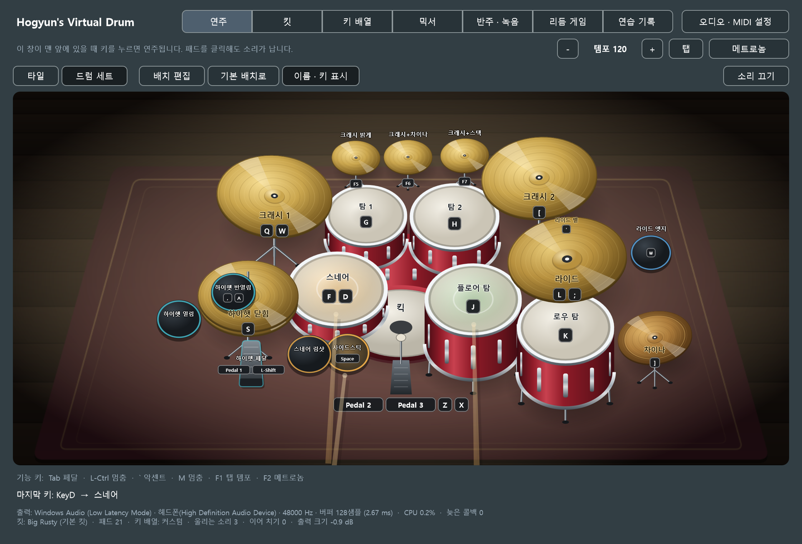
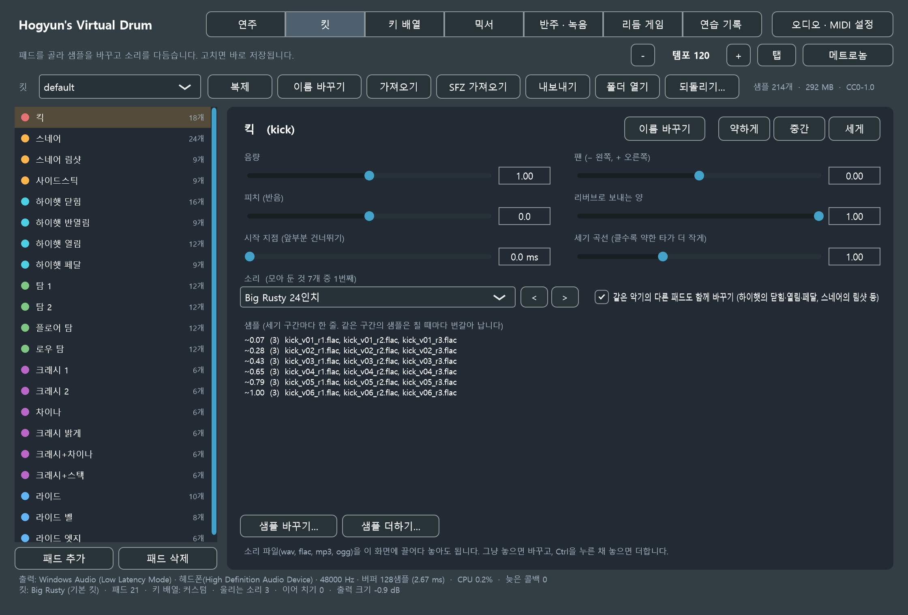

# Hogyun's Virtual Drum

PC 키보드(와 마우스, 풋스위치, MIDI 패드)로 연주하는 Windows용 가상 드럼입니다. 혼자 쓰려고 만든 취미 프로젝트이고, 화면은 한국어입니다.



## 할 수 있는 것

- **연주**: 키를 누르면 드럼이 울립니다. Raw Input으로 키를 받아 지연이 짧고, 내장 사운드에서 2.7ms 버퍼(WASAPI 저지연 공유 모드)로 돕니다. 드럼 세트 그림의 패드를 마우스로 눌러도 됩니다.
- **키 배열**: 키마다 어느 패드를 어떤 세기로 칠지 화면에서 정합니다. 누르고 있는 동안 이어지는 연타, 버즈 롤, 심벌 스웰(점점 커지는 연타), 더블, 플램, 패턴 반복, 세기 보조 키가 있습니다.
- **풋스위치**: 키보드로 인식되는 USB 풋스위치를 페달로 등록해, 키보드의 같은 글자 키와 따로 쓸 수 있습니다.
- **킷**: 패드마다 음량, 팬, 피치, 리버브, 세기 곡선을 다듬고, 모아 둔 소리 가운데 하나를 골라 씁니다. SFZ 킷을 가져올 수 있습니다.
- **믹서와 이펙트**: 드럼 전체에 EQ, 컴프레서, 리버브, 리미터가 걸립니다.
- **반주와 녹음**: 음악 파일을 틀고 따라 칩니다. 속도를 바꿔도 음높이는 그대로이고, 구간 반복이 됩니다. 친 것을 WAV로 녹음하거나 MIDI로 내보냅니다.
- **리듬 게임**: 음악 폴더의 곡에서 드럼을 받아 적어 채보를 만들고, 내려오는 노트에 맞춰 칩니다.
- **연주 로그와 연습 기록**: 켜져 있는 동안 친 것이 저절로 파일에 남습니다. 곡을 틀고 따라 친 연주는 박자가 얼마나 맞았는지(악기별, 곡의 구간별) 화면에서 볼 수 있습니다.
- **자동 백업**: 킷과 키 배열을 고칠 때마다 고치기 전의 상태가 남고, 화면에서 되돌릴 수 있습니다.

| 리듬 게임 | 키 배열 |
|---|---|
|  |  |

| 킷 | 믹서 |
|---|---|
|  |  |

## 빌드

필요한 것:

- Windows 10 또는 11 (64비트)
- Visual Studio Build Tools (C++ 워크로드), CMake 3.22 이상, Ninja
- PowerShell 7 (`pwsh`), git

```powershell
pwsh scripts/fetch-juce.ps1     # JUCE 9.0.6을 external/JUCE에 받는다 (처음 한 번)
pwsh scripts/build.ps1 -Run     # 빌드하고 실행한다
pwsh scripts/test.ps1           # 빌드하고 자동 테스트를 돌린다
```

실행 파일은 `build/release/HogyunsVirtualDrum_artefacts/Release/HogyunsVirtualDrum.exe`에 생깁니다. 프로그램은 저장소 폴더의 `kits/`와 `keymaps/`를 읽으므로 그 자리에서 실행합니다.

검사용 실행 옵션:

- `--selftest <보고서.txt>`: 창 없이 주요 기능을 차례로 검사합니다(약 30초, 소리는 나지 않습니다).
- `--screenshot <파일.png> --page play|kit|keys|mixer|track|game|practice|gameplay`: 화면을 그려 PNG로 저장합니다.

## 리듬 게임의 채보

채보는 이 저장소에 들어 있지 않습니다. 가지고 있는 음악 파일에서 각자 만듭니다.

- 프로그램의 리듬 게임 화면에서 곡을 고르고 "채보 만들기"를 누르거나, `pwsh scripts/make-charts.ps1`로 음악 폴더 전체를 한꺼번에 만듭니다.
- 드럼 분리 도구(Demucs)를 설치하면 드럼만 분리한 소리에서 받아 적어 더 정확합니다: `pwsh tools/setup-demucs.ps1` (Python 3.12 필요. NVIDIA 그래픽 카드가 있으면 훨씬 빠릅니다).
- 자동으로 받아 적은 것이라 완벽하지 않습니다. 킥과 스네어는 잘 맞는 편이고, 심벌과 탐은 덜 믿을 만합니다.

## 폴더

| 폴더 | 내용 |
|---|---|
| `src/core/` | 사운드 엔진, 키 배열 해석, 채보와 판정 등. JUCE를 쓰지 않는 순수 C++ |
| `src/app/` | 화면, 오디오 장치, 키보드 입력 등 JUCE 쪽 |
| `tests/` | 코어 자동 테스트 (본 프로그램에 함께 들어가고 `--coretests`로 돕니다) |
| `kits/` | 드럼 킷. `kits/default/`가 기본 킷 |
| `keymaps/` | 키 배열 |
| `scripts/`, `tools/` | 빌드 스크립트, 샘플과 채보를 만드는 도구 |

프로그램이 쓰면서 만드는 폴더(`charts/`, `logs/`, `backups/`, `recordings/`)는 저장소에 넣지 않습니다. 설정은 `%APPDATA%\HogyunsVirtualDrum\`에 저장됩니다.

## 샘플

`kits/default/`의 소리는 모두 CC0 1.0(퍼블릭 도메인 기증)으로 공개된 아래 라이브러리에서 만들었습니다. 마이크별 파일을 섞고 48kHz로 바꾼 것입니다.

- [Karoryfer Big Rusty Drums](https://github.com/sfzinstruments/karoryfer.big-rusty-drums)
- [Karoryfer Frankensnare](https://github.com/sfzinstruments/karoryfer.frankensnare)
- [Karoryfer Unruly Drums](https://github.com/sfzinstruments/karoryfer.unruly-drums)
- [Karoryfer Swirly Drums](https://github.com/sfzinstruments/karoryfer.swirly-drums)
- [Karoryfer The Hat With The Phat](https://github.com/sfzinstruments/Karoryfer.TheHatWithThePhat)
- [Virtuosity Drums](https://github.com/sfzinstruments/virtuosity_drums)

원본에서 다시 만들려면 `pwsh scripts/fetch-samples.ps1`로 라이브러리를 받고(5.9GB) `python -I tools/build_sounds.py`를 돌립니다(ffmpeg 필요).

## 라이선스

이 저장소의 프로그램은 [GNU AGPLv3](LICENSE)로 공개합니다.

- [JUCE](https://juce.com)를 씁니다. JUCE는 AGPLv3와 상용 라이선스의 이중 라이선스이고, 이 저장소에는 들어 있지 않습니다(빌드할 때 받습니다).
- 샘플은 위에 적은 대로 CC0 1.0입니다.
- 음악 파일과 거기서 만든 채보는 들어 있지 않습니다.
