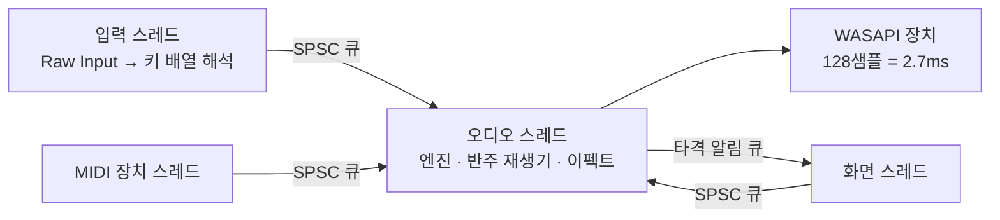

# Hogyun's Virtual Drum

PC 키보드(와 마우스, 풋스위치, MIDI 패드)로 연주하는 Windows용 가상 드럼입니다. 혼자 쓰려고 만든 취미 프로젝트이고, 화면은 한국어입니다.


## 할 수 있는 것

- **연주**: 키를 누르면 드럼이 울립니다. Raw Input으로 키를 받아 지연이 짧고, 내장 사운드에서 2.7ms 버퍼(WASAPI 저지연 공유 모드)로 돕니다. 드럼 세트 그림의 패드를 마우스로 눌러도 됩니다.
- **키 배열**: 키마다 어느 패드를 어떤 세기로 칠지 화면에서 정합니다. 누르고 있는 동안 이어지는 연타, 버즈 롤, 심벌 스웰(점점 커지는 연타), 더블, 플램, 패턴 반복, 세기 보조 키가 있습니다.
- **풋스위치**: 키보드로 인식되는 USB 풋스위치를 페달로 등록해, 키보드의 같은 글자 키와 따로 쓸 수 있습니다.
- **킷**: 패드마다 음량, 팬, 피치, 리버브, 세기 곡선을 다듬고, 모아 둔 소리 가운데 하나를 골라 씁니다. SFZ 킷을 가져올 수 있습니다.
- **믹서와 이펙트**: 드럼 전체에 EQ, 컴프레서, 리버브, 리미터가 걸립니다.
- **반주와 녹음**: 음악 파일을 틀고 따라 칩니다. 속도를 바꿔도 음높이는 그대로이고, 구간 반복이 됩니다. 친 것을 WAV로 녹음하거나 MIDI로 내보냅니다.
- **리듬 게임**: 음악 폴더의 곡에서 드럼을 받아 적어 채보를 만들고, 내려오는 노트에 맞춰 칩니다.
- **연주 로그와 연습 기록**: 켜져 있는 동안 친 것이 저절로 파일에 남습니다. 곡을 틀고 따라 친 연주는 박자가 얼마나 맞았는지(악기별, 곡의 구간별) 화면에서 볼 수 있습니다.
- **자동 백업**: 킷과 키 배열을 고칠 때마다 고치기 전의 상태가 남고, 화면에서 되돌릴 수 있습니다.

| 리듬 게임 | 키 배열 |
|---|---|
|  |  |

| 킷 | 믹서 |
|---|---|
|  |  |

## 기술 스택

| 영역 | 사용한 것 |
|---|---|
| 언어 | C++20 (MSVC) |
| 프레임워크 | JUCE 9.0.6 (화면, 오디오 장치, 파일 형식). 코어 로직은 JUCE 없이 순수 C++ |
| 오디오 출력 | WASAPI 저지연 공유 모드, 128샘플(48kHz에서 2.7ms) 버퍼. ASIO 없이 내장 사운드로 |
| 입력 | Win32 Raw Input (키보드, 풋스위치), MIDI |
| 빌드 | CMake + Ninja. JUCE의 CMake 함수를 쓰지 않고 모듈 소스를 직접 컴파일 |
| 드럼 분리 | Demucs 4.1 (htdemucs) + PyTorch 2.8 (CUDA) |
| 도구 | Python 3.12, ffmpeg, PowerShell 7 |
| 데이터 | JSON (킷, 키 배열, 채보), JSON Lines (연주 로그) |

규모는 C++ 약 27,000줄입니다(코어 6,800줄, 앱 17,500줄, 테스트 2,800줄).

## 구조

### 잠금 없는 오디오 경로

악기는 누른 순간 소리가 나야 합니다. 그래서 키 입력부터 소리까지의 길에는 잠금도, 메모리 할당도 없습니다.



- **키보드는 화면과 다른 스레드에서 받습니다.** Win32 Raw Input 전용 스레드가 키를 받아 곧바로 엔진에 지시를 보냅니다. 화면을 그리느라 메시지 루프가 바빠도 연주는 밀리지 않습니다.
- **보내는 스레드마다 큐를 따로 둡니다.** 입력, 화면, MIDI 세 스레드가 각자의 SPSC(단일 생산자·단일 소비자) 큐로 엔진에 지시를 넣습니다. 큐마다 쓰는 쪽과 읽는 쪽이 하나씩뿐이라 잠금도 CAS 재시도도 필요 없습니다.
- **오디오 콜백 안에서는 메모리 할당, 잠금, 파일 접근, 로그 출력을 하지 않습니다.** 킷을 바꿀 때도 새 킷의 포인터만 지시로 넘기고, 엔진이 내려놓은 예전 킷은 큐로 돌려받아 화면 스레드에서 지웁니다.
- 엔진은 96보이스이고, 세기 레이어와 라운드 로빈, 초크 그룹(하이햇을 닫으면 열린 소리가 끊김), 3밴드 EQ·컴프레서·리버브를 직접 구현했습니다.

### 샘플 단위의 타이밍

- **연타는 오디오 스레드가 직접 칩니다.** 키를 누르고 있는 동안 이어지는 롤, 버즈, 패턴, 심벌 스웰은 입력 스레드가 타이머로 치는 것이 아니라 엔진 안에서 샘플 단위로 만들어집니다. 그래서 간격이 스레드 스케줄링에 흔들리지 않습니다.
- **대신 쳐 주는 타격은 시각을 정해 미리 넘깁니다.** 리듬 게임의 오토 모드와 연주 다시 재생은 0.3초쯤 앞의 타격을 엔진 시계 기준의 시각으로 예약합니다. 화면 스레드가 잠깐 늦어져도 타이밍은 샘플 단위로 맞습니다.
- **타격마다 곡의 어느 자리였는지 압니다.** 오디오 스레드가 블록마다 "엔진 시계와 반주 위치의 짝"을 시퀀스 번호와 함께 적어 두고(seqlock 방식), 다른 스레드는 잠금 없이 읽어 타격의 시각을 곡 안의 위치로 바꿉니다. 리듬 게임의 판정과 연습 기록이 이 값을 씁니다.
- **반주는 속도를 바꿔도 음높이가 그대로입니다.** WSOLA 방식의 타임 스트레칭을 직접 구현했습니다.
- **리미터는 지연이 없습니다.** 미리 보기(look-ahead) 없이 넘는 샘플에서 바로 게인을 내리는 방식이라, 음량을 키우면서도 누른 뒤 소리가 나기까지의 시간이 늘지 않습니다.

### 코어와 앱의 분리, 그리고 검증

- `src/core/`는 JUCE를 전혀 쓰지 않는 순수 C++입니다(엔진, 이펙트, 키 배열 해석, 반주 재생기, 채보, 판정, 드럼 받아 적기). 화면이나 장치 없이 테스트할 수 있습니다.
- **자동 테스트**는 외부 프레임워크 없이 본 프로그램에 함께 들어 있습니다. 테스트 함수 53개, 검사 1,072개이고 `--coretests`로 돕니다. 엔진이 낸 소리의 샘플 위치와 크기를 직접 확인합니다.
- **자체 검사**(`--selftest`)는 창 없이 프로그램 전체를 30초쯤 돌려 봅니다. 실제 오디오 장치를 열어(무음으로) 키 입력부터 출력까지를 지나가게 하고, WAV 녹음, 반주 재생, MIDI 내보내기와 불러오기, 리듬 게임의 시범 연주가 모두 정확한 시각에 판정되는지, 연주 로그와 백업이 제대로 남는지 확인합니다.
- **화면**은 `--screenshot`으로 PNG로 그려 눈으로 확인합니다. 드럼 세트 그림은 이미지 파일 없이 전부 코드로 그립니다.

### 곡에서 채보까지

리듬 게임의 채보는 가지고 있는 음악 파일에서 자동으로 만듭니다.

1. **드럼 분리**: Demucs로 곡에서 드럼만 분리합니다. 4분짜리 곡이 GPU(RTX 5060)에서 약 6초 걸립니다. 드럼을 뺀 나머지는 반주로 저장해, 게임에서는 원곡의 드럼 없이 따라 칠 수 있습니다.
2. **받아 적기**: 직접 만든 C++ 코드(`DrumTranscriber`)가 드럼 소리에서 타격을 찾습니다. 낮은·가운데·높은 대역에서 따로 타격을 찾고, 그 곡의 킥과 스네어의 "본"을 떠서 동시에 친 타격을 킥 몇 개분 + 스네어 몇 개분으로 풀고, 탐은 음높이로, 크래시는 세기와 여운으로, 하이햇과 라이드는 스테레오의 좌우 위치로 가릅니다. 박도 함께 찾습니다.
3. **단계 만들기**: 채보 파일에는 받아 적은 전부를 저장하고, 난이도 단계는 읽을 때 덜어 냅니다. 덜어 내는 규칙을 바꿔도 다시 분석할 필요가 없습니다.

여러 곡을 한꺼번에 처리할 때는 GPU 분리는 한 곡씩 하고, 곡을 풀고 받아 적고 반주를 저장하는 CPU 쪽 일을 그 앞뒤에 겹쳐 돌립니다. 음악 폴더 전체(2,600여 곡)를 4시간 15분에 처리했습니다(곡당 약 6초).

얼마나 맞는지는 사람이 직접 친 연주(한 곡, 1,070타)와 견줘 보았습니다. 80ms 안에서 같은 자리에 있는 비율이 킥 95%, 스네어 85%, 하이햇·라이드 86%였습니다. 크래시는 16%로 대부분 놓치고, 탐은 자리는 비슷해도 어느 탐인지를 자주 틀립니다.

### 그 밖에

- **풋스위치 구분**: USB 풋스위치는 Windows에 키보드로 잡혀 글자 키를 보냅니다. Raw Input이 주는 장치의 제조사·제품 번호로 그 장치를 알아보고, 거기서 온 키만 따로 있는 "페달" 키로 바꿔서 키보드의 같은 글자와 구분합니다. 누르고 뗀 시각들로 장치의 USB 보고 간격도 어림합니다.
- **연주 로그**: 타격이 어디서 왔는지(어느 키, 마우스, MIDI, 오토 모드)를 엔진을 지나 타격 알림까지 실어 보내, 친 것을 한 줄에 JSON 하나로 남깁니다. 연습 기록 화면은 이 로그와 채보의 박을 견줘 악기별, 곡의 구간별 박자를 냅니다.
- **킷과 키 배열**: JSON 파일을 밖에서 고쳐 저장하면 켜져 있는 프로그램이 바로 다시 읽습니다. 바뀔 때마다 이전 내용을 백업하고, 오래된 백업은 시간이 지날수록 성기게 솎아 냅니다.
- **샘플 만들기**: Python과 ffmpeg로 마이크별로 녹음된 CC0 라이브러리를 섞고, 세기 레이어와 라운드 로빈을 골라 담고, 소리끼리 음량을 맞춥니다. 이렇게 만든 소리 125개 가운데 패드마다 하나를 골라 씁니다.

## 빌드

필요한 것:

- Windows 10 또는 11 (64비트)
- Visual Studio Build Tools (C++ 워크로드), CMake 3.22 이상, Ninja
- PowerShell 7 (`pwsh`), git

```powershell
pwsh scripts/fetch-juce.ps1     # JUCE 9.0.6을 external/JUCE에 받는다 (처음 한 번)
pwsh scripts/build.ps1 -Run     # 빌드하고 실행한다
pwsh scripts/test.ps1           # 빌드하고 자동 테스트를 돌린다
```

실행 파일은 `build/release/HogyunsVirtualDrum_artefacts/Release/HogyunsVirtualDrum.exe`에 생깁니다. 프로그램은 저장소 폴더의 `kits/`와 `keymaps/`를 읽으므로 그 자리에서 실행합니다.

검사용 실행 옵션:

- `--selftest <보고서.txt>`: 창 없이 주요 기능을 차례로 검사합니다(약 30초, 소리는 나지 않습니다).
- `--screenshot <파일.png> --page play|kit|keys|mixer|track|game|practice|gameplay`: 화면을 그려 PNG로 저장합니다.

## 리듬 게임의 채보

채보는 이 저장소에 들어 있지 않습니다. 가지고 있는 음악 파일에서 각자 만듭니다.

- 프로그램의 리듬 게임 화면에서 곡을 고르고 "채보 만들기"를 누르거나, `pwsh scripts/make-charts.ps1`로 음악 폴더 전체를 한꺼번에 만듭니다.
- 드럼 분리 도구(Demucs)를 설치하면 드럼만 분리한 소리에서 받아 적어 더 정확합니다: `pwsh tools/setup-demucs.ps1` (Python 3.12 필요. NVIDIA 그래픽 카드가 있으면 훨씬 빠릅니다).
- 자동으로 받아 적은 것이라 완벽하지 않습니다. 킥과 스네어는 잘 맞는 편이고, 심벌과 탐은 덜 믿을 만합니다.

## 폴더

| 폴더 | 내용 |
|---|---|
| `src/core/` | 사운드 엔진, 키 배열 해석, 채보와 판정 등. JUCE를 쓰지 않는 순수 C++ |
| `src/app/` | 화면, 오디오 장치, 키보드 입력 등 JUCE 쪽 |
| `tests/` | 코어 자동 테스트 (본 프로그램에 함께 들어가고 `--coretests`로 돕니다) |
| `kits/` | 드럼 킷. `kits/default/`가 기본 킷 |
| `keymaps/` | 키 배열 |
| `scripts/`, `tools/` | 빌드 스크립트, 샘플과 채보를 만드는 도구 |

프로그램이 쓰면서 만드는 폴더(`charts/`, `logs/`, `backups/`, `recordings/`)는 저장소에 넣지 않습니다. 설정은 `%APPDATA%\HogyunsVirtualDrum\`에 저장됩니다.

## 샘플

`kits/default/`의 소리는 모두 CC0 1.0(퍼블릭 도메인 기증)으로 공개된 아래 라이브러리에서 만들었습니다. 마이크별 파일을 섞고 48kHz로 바꾼 것입니다.

- [Karoryfer Big Rusty Drums](https://github.com/sfzinstruments/karoryfer.big-rusty-drums)
- [Karoryfer Frankensnare](https://github.com/sfzinstruments/karoryfer.frankensnare)
- [Karoryfer Unruly Drums](https://github.com/sfzinstruments/karoryfer.unruly-drums)
- [Karoryfer Swirly Drums](https://github.com/sfzinstruments/karoryfer.swirly-drums)
- [Karoryfer The Hat With The Phat](https://github.com/sfzinstruments/Karoryfer.TheHatWithThePhat)
- [Virtuosity Drums](https://github.com/sfzinstruments/virtuosity_drums)

원본에서 다시 만들려면 `pwsh scripts/fetch-samples.ps1`로 라이브러리를 받고(5.9GB) `python -I tools/build_sounds.py`를 돌립니다(ffmpeg 필요).

## 라이선스

이 저장소의 프로그램은 [GNU AGPLv3](LICENSE)로 공개합니다.

- [JUCE](https://juce.com)를 씁니다. JUCE는 AGPLv3와 상용 라이선스의 이중 라이선스이고, 이 저장소에는 들어 있지 않습니다(빌드할 때 받습니다).
- 샘플은 위에 적은 대로 CC0 1.0입니다.
- 음악 파일과 거기서 만든 채보는 들어 있지 않습니다.
